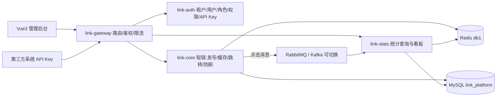

# 需求与架构：多租户营销短链平台

> 本文回答三个问题：**这产品是什么、微服务化带来了什么价值、按什么版本路线演进。**
> 前置结论：不做从零开始的商城/CRM，做"短链平台自身的产品化（多租户 SaaS）"。

---

## 1. 产品定位与真实对标

一句话概括（面试版）：

> "我把单体的短链服务演进成了多租户的营销短链平台：租户通过管理后台或 API 创建带渠道标识的短链，
> 投放到短信/邮件/社媒，点击数据回流到统计模块形成渠道效果报表。"

**真实对标**：Bitly / Shlink / 小米短链。不是凭空发明的玩具业务——短链产品的核心能力（发号、跳转、统计、配额、API）在这些真实产品里都有对应。

**业务主线**：`租户 → 活动 → 渠道 → 短链 → 点击统计 → 渠道效果报表`

---

## 2. 微服务化后"能实现什么"：能力升级对比

| 能力 | AAE 单体（迁移前） | AAF 微服务化后 | 商业含义 |
|---|---|---|---|
| 多租户 | 单管理员，无租户概念 | 租户开通、数据隔离、按租户配额（quota_per_day） | **计费模型的产品基础** |
| 渠道归因 | 只有 gid 分组 | 短链带活动/渠道标识，点击按渠道归因 | **营销投放 ROI 分析入口** |
| 开放 API | 无 | API Key + 签名 + 配额限流 | 可被短信平台/CRM/电商**按量集成** |
| 权限合规 | 无 | 平台/租户/只读三级 RBAC + 审计日志 | 企业客户采购的**合规门槛** |
| 独立扩容 | 全挤一个进程 | 跳转 / 管理 / 统计各自按需扩 | 成本与稳定性 |
| 故障隔离 | 一挂全挂 | auth 挂了存量短链照跳；stats 挂了点击进 MQ 不丢 | 可用性 |

---

## 3. 为什么要微服务（技术作用）

1. **流量特征不同**：跳转链路读多写少、要求低延迟（core）；管理端写多读少（auth）；统计写入吞吐大（stats）。拆开才能各自独立扩容与调优。
2. **故障半径控制**：认证挂了不影响跳转（存量短链继续 302）；统计挂了点击消息在 MQ 里缓冲不丢。
3. **统一入口**：网关做 JWT 前置校验、限流、白名单，业务服务不重复造鉴权。
4. **中间件可切换**：MQ 抽象成 RabbitMQ / Kafka 可切换，为不同规模客户提供同构不同配的部署。
5. **有对比数据**：拆分前后做压测对比（QPS / RT），能讲清"拆分的收益与代价"。

---

## 4. 作为模拟商业项目的卖点（面试讲法）

1. **有真实对标**：Bitly / Shlink，不是玩具。
2. **商业闭环有影子**：租户配额 = 计费前置；渠道归因 = 投放 ROI；API 配额 = 按量售卖；审计日志 = 企业合规。
3. **技术深度有据**：缓存三大问题防护、MQ 幂等/死信、多租户越权防护、四种发号器。
4. **过程可信**：198 个单测、压测报告、逐版本开发日志——这是**最难伪造的证据链**。

---

## 5. 系统架构

> 说明：P0 阶段只交付"地基"（多模块骨架 + 核心迁入 + 公共类上移），上图中 auth/gateway/stats 的真实能力在 P1~P5 渐进补齐。

---

## 6. 模块划分与依赖方向

| 模块 | 职责 | P0 状态 |
|---|---|---|
| `link-common` | 统一返回、异常、租户上下文、常量 | 有真实代码 |
| `link-core` | 短链发号 / 缓存 / 跳转 / 布隆 / 降级 / 统计 | 迁移主体 |
| `link-gateway` | 路由、JWT 校验、限流 | 仅骨架 |
| `link-auth` | 租户 / 用户 / 角色 / 权限、双 Token、API Key | 仅骨架 |
| `link-stats` | 统计消费与看板查询 | 仅骨架 |

**依赖方向（单向，禁循环）**：`link-common ← link-core / link-gateway / link-auth / link-stats`

**端口分配**：gateway 8080 / auth 8081 / core 8082 / stats 8083（AAE 单体已占 8080，避免冲突）。

---

## 7. 技术栈

| 类别 | 选型 |
|---|---|
| 语言/构建 | Java 17 + Maven 3.9.5 多模块 |
| 基础框架 | Spring Boot 3.2.5 |
| 微服务 | Spring Cloud 2023.0.3 + Spring Cloud Alibaba 2023.0.3.2（P0 仅 BOM，P2/P3 接 Nacos/Sentinel） |
| 持久层 | MyBatis-Plus 3.5.7 + MySQL 8 |
| 缓存/MQ | Redis（db 1）+ Caffeine + RabbitMQ（拓扑名 link.visit.*，P5 可切 Kafka） |
| 工具/文档 | Hutool、Lombok、Knife4j + springdoc |
| 测试 | JUnit 5 + Mockito |

---

## 8. 版本路线图（V0~V7 ↔ P0~P7）

| 版本 | 阶段 | 目标 | 验收标准（能讲什么） | 天数 |
|---|---|---|---|---|
| **V0** | P0 | 多模块骨架 + 短链核心迁移 | 编译通过 + 198 单测全绿 | 1~2 |
| **V1** | P1 | 包名/前缀规范化 + link-auth 认证链路与租户模型（RBAC 做到"认证链路 + 租户两级"；API Key 本阶段只建表） | 租户模型、Token 撤销、越权防护、多租户隔离（core 198 + auth 28 单测、E2E 9 步） | 2~3 |
| **V2** | P2 | 前置技术债清理 + Nacos 注册/配置中心 + OpenFeign 互通（Feign 仅打通链路，探活接口**非业务功能**） | 注册发现、配置动态刷新、容错模式（core 198 + auth 28 单测、E2E 7 项 + 容错 2 场景） | 1~2 |
| **V3** | P3 | Gateway 路由 + 鉴权前置（身份透传 + 防伪造）+ Sentinel 两层限流与熔断降级 | 网关鉴权前置、身份透传防伪造、两层限流、Feign 熔断降级、与手写限流/降级闸门对比（gateway 6 + auth 28 + core 202 单测、E2E 10 项） | 1~2 |
| **V4** | P4 | core 多租户隔离（tenant_id 管理链路）+ 渠道归因 + API Key 开放接口 + 跳转防刷 | 多租户隔离、渠道归因、API 签名/配额、跳转防刷（gateway 6 + auth 28 + core 220 单测、E2E 9 项） | 1~2 |
| **V5** | P5 | MQ 可切换（RabbitMQ ↔ Kafka）+ retry topic/DLT 死信 + 幂等复用（统计消费仍在 core） | 两种 MQ 取舍、薄抽象 vs Spring Cloud Stream、Kafka 无原生死信的补法（gateway 6 + auth 28 + core 233 单测、Kafka/Rabbit 双模式 E2E） | 1 |
| V6 | P6 | Vue3 管理后台 + 数据看板 | 前后端联调、图表聚合 | 3~4 |
| V7 | P7 | Docker Compose 编排 + 压测对比 + README | 拆分收益与代价（多一跳的 RT 影响） | 1~2 |

---

## 9. 每个版本的完成定义（DoD 四件套）

一个版本只有**同时满足**以下四件才算完成，缺一不算：

1. **编译通过**：`mvn clean install` 全部模块 BUILD SUCCESS；
2. **测试数字记录**：`mvn clean test` 的 `Tests run / Failures / Errors / Skipped` 写进该版本 devlog；
3. **文档更新**：`docs/devlog/Vx-*.md` 按七小节写齐，并在 `docs/02-开发日志.md` 索引登记；
4. **代码提交**：git commit，形成可回滚的安全点。

---

## 10. 开发环境与隔离约定

| 资源 | AAE 单体（不动） | AAF 平台（本仓库） |
|---|---|---|
| MySQL 库 | `short_link` | `link_platform`（新建空库，不复制数据） |
| Redis | db 0 | db 1（`CacheKeyBuilder` 的 key 前缀是硬编码常量，改不了，只能换库） |
| RabbitMQ 拓扑 | `short-link.visit.*` | `link.visit.*`（纯配置，`RabbitMqConfig` 读 `ShortLinkProperties` 无硬编码） |

> 关键约束：**AAE 仓库与其环境一字不动**，它是 P7"单体 vs 微服务"压测对比的基线与面试演进故事本体。
